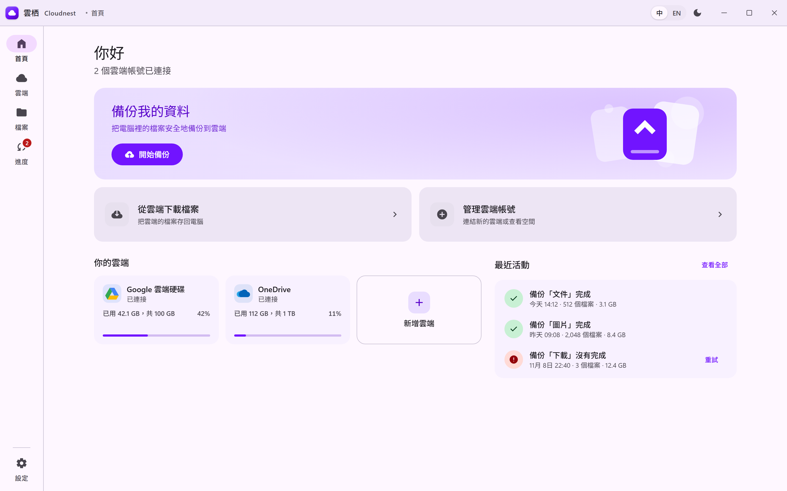

# 雲栖 Cloudnest

[](https://github.com/Miku0139oao/cloudnest/actions/workflows/ci.yml)

> 傻瓜式的 rclone 桌面 GUI。把電腦裡的檔案備份到雲端，不需要懂 rclone。
>
> A fool-proof desktop GUI for rclone. Back up your files without learning rclone.



## 為什麼

rclone 很強，但對一般使用者來說是命令列、設定檔與參數。Cloudnest 把它包成三個動作：

1. 連接雲端帳號（瀏覽器授權，一鍵完成）
2. 備份資料夾（選資料夾 → 選雲端 → 開始）
3. 看進度（「已備份 3.2 GB，還有約 4 分鐘」）

技術上：**Wails v3**（WebView2）+ **Svelte 5** + **Material Design 3**，紫色系。所有雲端操作都走本機的 `rclone rcd` RC API；憑證留在 Go 端，不進 webview。

## 目前狀態

已可運作：

- **帳號**：讀取既有 rclone remotes、容量（Drive 限流時自動重試與 CLI 備援）、瀏覽器授權新增、重新授權（保留原本名稱）、移除（只動設定）
- **瀏覽**：本機（含 KnownFolder）與雲端雙欄、目前資料夾搜尋、整個雲端遞迴搜尋
- **檔案操作**：上傳／下載（單檔與資料夾）、拖放上傳、重新命名、移動、複製到其他雲端帳號、新增資料夾、刪除、清空垃圾桶
- **備份**：`sync/copy`、鏡像模式（刪除預覽＋勾選確認）、排除規則、自動重試、限速、大檔案切片加速與還原
- **進度**：即時速度／剩餘時間、暫停／續傳／取消、歷史紀錄（重啟後保留）、中斷後一鍵續傳
- **其他**：分享連結、檔案雜湊（SHA-256／MD5）、備份驗證（`rclone check`）、每日排程備份、掛載成磁碟機（需 WinFsp）、中英切換、明暗主題、視窗尺寸記憶

系統匣：設定排程後，關閉視窗會縮到系統匣繼續執行，托盤選單可真正結束。

尚未包含：多螢幕混合 DPI 的實機驗證。程式碼簽章使用 Microsoft Trusted Signing（Azure），本機與 CI 都可在有憑證的情況下自動簽署；沒有憑證的建置仍可執行，但會觸發 SmartScreen 警告。

## 螢幕截圖

| 檔案 | 畫面 |
|---|---|
|  | 首頁（深色） |
|  | 備份嚮導：鏡像刪除警告 |
|  | 新增雲端：一鍵授權 vs 進階 |
|  | 檔案雙欄＋切片項目 |
|  | 切片還原 |
|  | 進度 |
|  | 設定 |

預覽是純靜態、可離線開啟的設計定義：`preview/index.html`。同一份 `preview/styles/tokens.css` 直接沿用到 App。

## 開發

需求：Go 1.26+、Node 22+、Wails v3.1、rclone 1.70+（Windows）。

```powershell
go install github.com/wailsapp/wails/v3/cmd/wails3@v3.1.0
npm install --prefix frontend
wails3 generate bindings -ts -clean=true
wails3 dev
```

建置：

```powershell
wails3 build
# bin/cloudnest.exe
```

打包 portable ZIP（會一併簽章，若本機已設定 Trusted Signing）：

```powershell
pwsh scripts/package-portable.ps1 -Version 0.1.0
# dist/Cloudnest-0.1.0-win64.zip
```

### 程式碼簽章（Microsoft Trusted Signing / Artifact Signing）

`Cloudnest.exe` 在打包時會用 Authenticode 簽署，這樣 Windows 才會顯示可辨識的發行者。簽章步驟是選用的：工具不存在時只警告、照樣產出未簽章的 ZIP。

本機第一次使用時，把工具與帳戶資訊準備好（只需一次）：

```powershell
pwsh scripts/setup-trusted-signing.ps1 -OutDir "$HOME\lib" `
  -Endpoint https://eus.codesigning.azure.net/ `
  -Account <帳戶名稱> -Profile <憑證設定檔名稱>
```

之後 `scripts/package-portable.ps1` 會自動找到工具並簽章；單獨補簽用 `scripts/sign-windows.ps1 -Files <exe> -Required`。簽完會用 `Get-AuthenticodeSignature` 驗證，狀態不是 `Valid` 就失敗。

CI／Release 要在 GitHub Actions 上簽章時，設定這些 repository secrets（Azure 服務主體需要 Trusted Signing 的簽署者角色）：

| Secret | 說明 |
|---|---|
| `TRUSTED_SIGNING_ENDPOINT` | 例如 `https://eus.codesigning.azure.net/` |
| `TRUSTED_SIGNING_ACCOUNT` | Code Signing 帳戶名稱 |
| `TRUSTED_SIGNING_PROFILE` | 憑證設定檔名稱 |
| `TRUSTED_SIGNING_CORRELATION_ID` | 選用，預設同帳戶名稱 |
| `AZURE_TENANT_ID` / `AZURE_CLIENT_ID` / `AZURE_CLIENT_SECRET` | 服務主體憑證 |

只要 `TRUSTED_SIGNING_ACCOUNT` 沒有設定，工作流程就跳過簽章，維持原本的未簽章產物。

這個 repo 已經設定好上述 secrets，所以 CI 與 Release 產出的 ZIP 都是已簽章的；發佈說明會列出實際的簽署者。服務主體需要的是 Code Signing 帳戶上的 **Artifact Signing Certificate Profile Signer**（舊稱 Trusted Signing Certificate Profile Signer）角色，而且角色指派要幾分鐘才會生效。

維護：CI 用的應用程式憑證會在 **2028-11-14** 到期，屆時在該應用程式新增一組用戶端密碼並更新 `AZURE_CLIENT_SECRET` 即可。要撤銷簽章權限時，刪除該應用程式（`cloudnest-github-signing`）與其在 Code Signing 帳戶上的角色指派，並移除這 7 個 secrets。

只跑 UI（不需要 Wails / rclone）：

```powershell
cd frontend
npm run dev
# http://127.0.0.1:9245
```

## 專案結構

```
main.go                 Wails 入口、視窗、服務註冊
services/              唯一 Wails 綁定層（前端只能透過這裡呼叫 rclone）
internal/
  engine/              rclone rcd 生命週期（隨機埠、Basic auth、Job Object 防孤兒）
  rc/                  rclone RC HTTP client
  oauth/               rclone authorize 子程序流程
  files/               本機檔案 + Windows KnownFolder
  split/               切片／還原／manifest（含測試）
  settings/            portable settings.json
  platform/            portable 路徑、開瀏覽器、磁碟空間、WinFsp 偵測
  dto/ apperr/         前端 wire types、錯誤分類
frontend/              Svelte 5 + Vite
preview/               靜態 UI 預覽 + 截圖
```

歷史紀錄存在 `data\history.json`，與 `settings.json`、`rclone.conf`、`logs\`、`staging\` 放在一起；整個資料夾刪掉就等於清除所有設定。

## 設計原則

- **零 rclone 詞彙**：UI 只說「雲端帳號」「備份」「進度」。技術詞收在「進階」。
- **不用填表**：授權走系統瀏覽器；資料夾用原生選擇器。
- **不騙人**：暫停＝停止後可續傳（rclone 沒有暫停），文案明說。
- **Portable**：ZIP 解壓即用，資料在程式資料夾 `data\`；不寫註冊表。
- **不收集資料**：無遥測。

## 下載

- **最新正式版**：[Releases](https://github.com/Miku0139oao/cloudnest/releases)（`v*` 標籤觸發）
- **Nightly**：每次 push 到 `main` 都會重建 [nightly 預發佈](https://github.com/Miku0139oao/cloudnest/releases/tag/nightly)，內容對應最新 commit
- 兩者都是 portable ZIP：解壓即用，不寫註冊表、沒有安裝程式
- ZIP 內的 `Cloudnest.exe` 若由有憑證的建置產出，會帶 Authenticode 簽章；可用 `Get-AuthenticodeSignature .\Cloudnest.exe` 檢查發行者

## 授權與致謝

本專案為 MIT 授權，條文見 [LICENSE](LICENSE)。內附的 [rclone](https://rclone.org/) 同樣是 MIT，打包時會一併附上其授權條文（`LICENSES\rclone-COPYING.txt`）。
