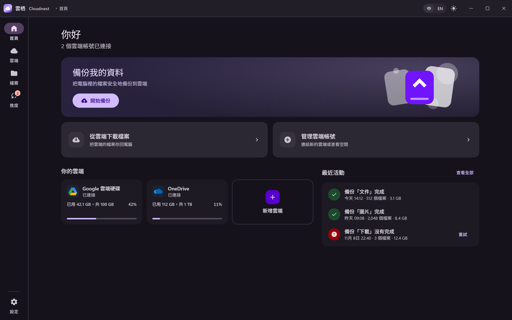
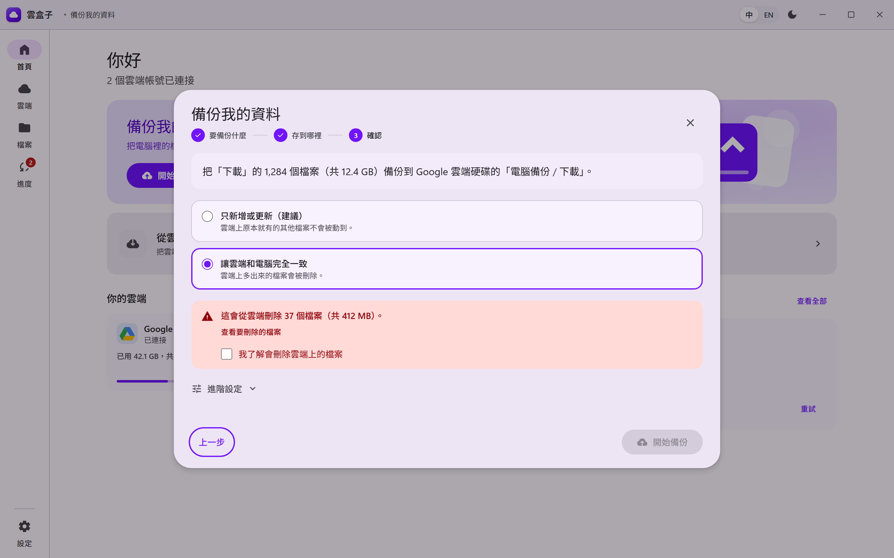
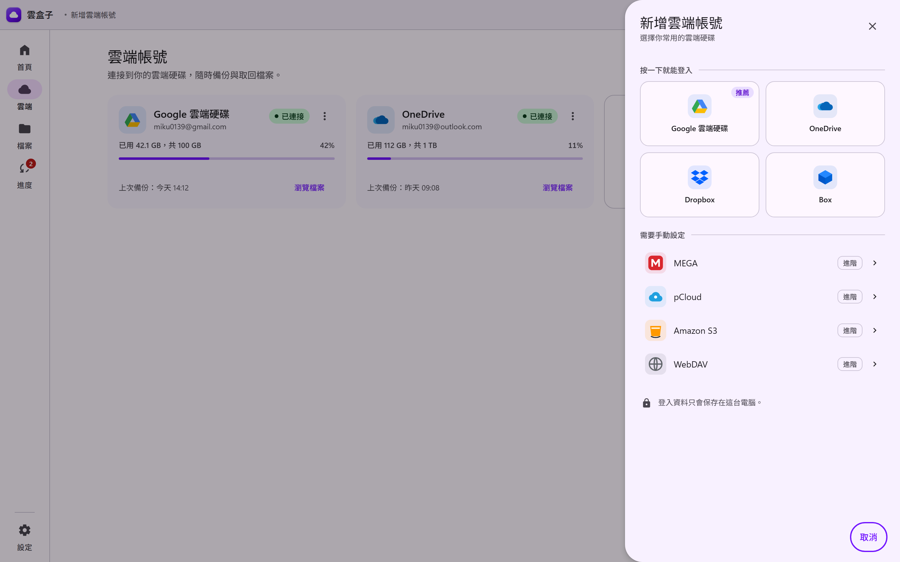
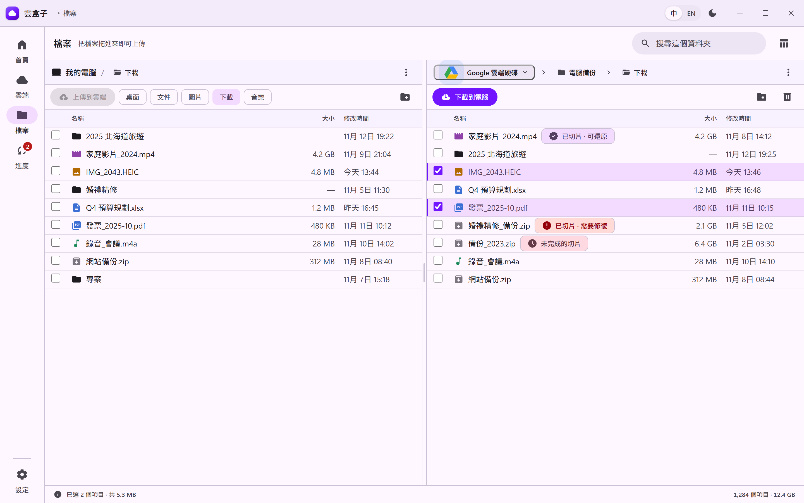
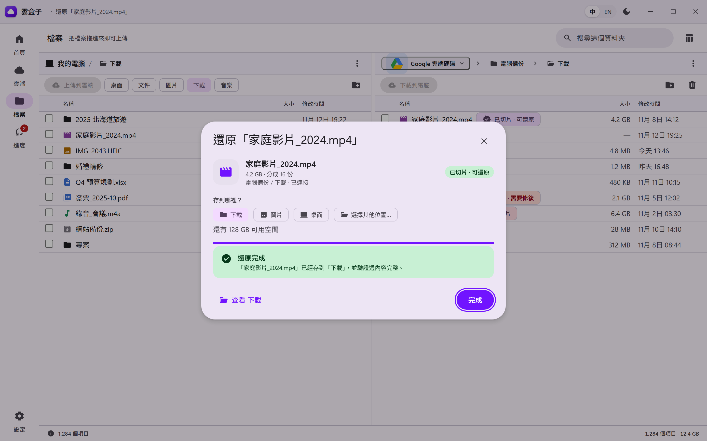
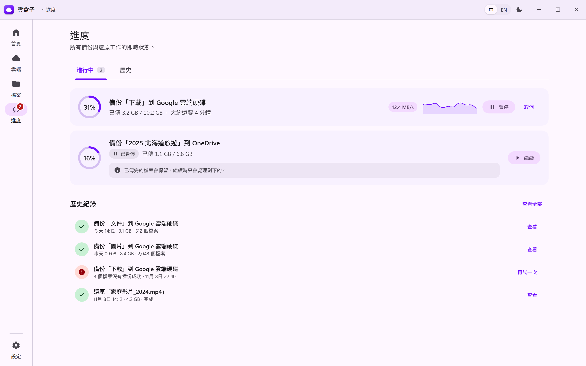
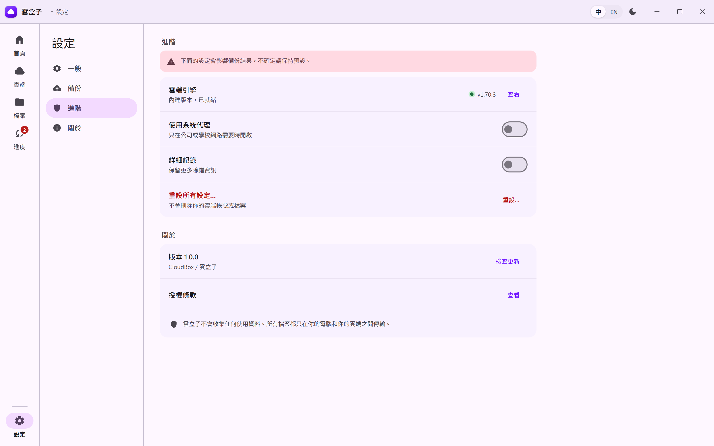

# 雲栖 Cloudnest

[](https://github.com/Miku0139oao/cloudnest/actions/workflows/ci.yml)

> 傻瓜式的 rclone 桌面 GUI。把電腦裡的檔案備份到雲端，不需要懂 rclone。
>
> A fool-proof desktop GUI for rclone. Back up your files without learning rclone.


## 為什麼

rclone 很強，但對一般使用者來說是命令列、設定檔與參數。Cloudnest 把它包成三個動作：

1. 連接雲端帳號（瀏覽器授權，一鍵完成）
2. 備份資料夾（選資料夾 → 選雲端 → 開始）
3. 看進度（「已備份 3.2 GB，還有約 4 分鐘」）

技術上：**Wails v3**（WebView2）+ **Svelte 5** + **Material Design 3**，紫色系。所有雲端操作都走本機的 `rclone rcd` RC API；憑證留在 Go 端，不進 webview。

## 目前狀態

早期開發中。已可運作：

- 讀取真實的 rclone remotes、Google Drive 容量
- 本機資料夾瀏覽（含 KnownFolder 重新導向，例如 OneDrive）
- 雲端資料夾瀏覽（`operations/list`）
- 新增雲端帳號：`rclone authorize` → 系統瀏覽器 → 自動寫入設定
- 移除雲端帳號（只移除設定，不動雲端檔案）
- 備份：`sync/copy`，即時進度（`core/stats`）

施工中：切片上傳／還原（`internal/split` 已完成並有測試）、鏡像模式 preflight、續傳 journal、系統匣。

## 螢幕截圖

| 檔案 | 畫面 |
|---|---|
|  | 首頁（深色） |
|  | 備份嚮導：鏡像刪除警告 |
|  | 新增雲端：一鍵授權 vs 進階 |
|  | 檔案雙欄＋切片項目 |
|  | 切片還原 |
|  | 進度 |
|  | 設定 |

預覽是純靜態、可離線開啟的設計定義：`preview/index.html`。同一份 `preview/styles/tokens.css` 直接沿用到 App。

## 開發

需求：Go 1.26+、Node 22+、Wails v3.1、rclone 1.70+（Windows）。

```powershell
go install github.com/wailsapp/wails/v3/cmd/wails3@v3.1.0
npm install --prefix frontend
wails3 generate bindings -ts -clean=true
wails3 dev
```

建置：

```powershell
wails3 build
# bin/cloudnest.exe
```

只跑 UI（不需要 Wails / rclone）：

```powershell
cd frontend
npm run dev
# http://127.0.0.1:9245
```

## 專案結構

```
main.go                 Wails 入口、視窗、服務註冊
services/              唯一 Wails 綁定層（34 個方法）
internal/
  engine/              rclone rcd 生命週期（隨機埠、Basic auth、Job Object 防孤兒）
  rc/                  rclone RC HTTP client
  oauth/               rclone authorize 子程序流程
  files/               本機檔案 + Windows KnownFolder
  split/               切片／還原／manifest（含測試）
  settings/            portable settings.json
  platform/            portable 路徑、開瀏覽器、磁碟空間
  dto/ apperr/         前端 wire types、錯誤分類
frontend/              Svelte 5 + Vite
preview/               靜態 UI 預覽 + 截圖
```

## 設計原則

- **零 rclone 詞彙**：UI 只說「雲端帳號」「備份」「進度」。技術詞收在「進階」。
- **不用填表**：授權走系統瀏覽器；資料夾用原生選擇器。
- **不騙人**：暫停＝停止後可續傳（rclone 沒有暫停），文案明說。
- **Portable**：ZIP 解壓即用，資料在程式資料夾 `data\`；不寫註冊表。
- **不收集資料**：無遥測。

## 下載

- **最新正式版**：[Releases](https://github.com/Miku0139oao/cloudnest/releases)（`v*` 標籤觸發）
- **Nightly**：每次 push 到 `main` 都會重建 [nightly 預發佈](https://github.com/Miku0139oao/cloudnest/releases/tag/nightly)，內容對應最新 commit
- 兩者都是 portable ZIP：解壓即用，不寫註冊表、沒有安裝程式

## 授權與致謝

本專案為 MIT 授權，條文見 [LICENSE](LICENSE)。內附的 [rclone](https://rclone.org/) 同樣是 MIT，打包時會一併附上其授權條文（`LICENSES\rclone-COPYING.txt`）。
